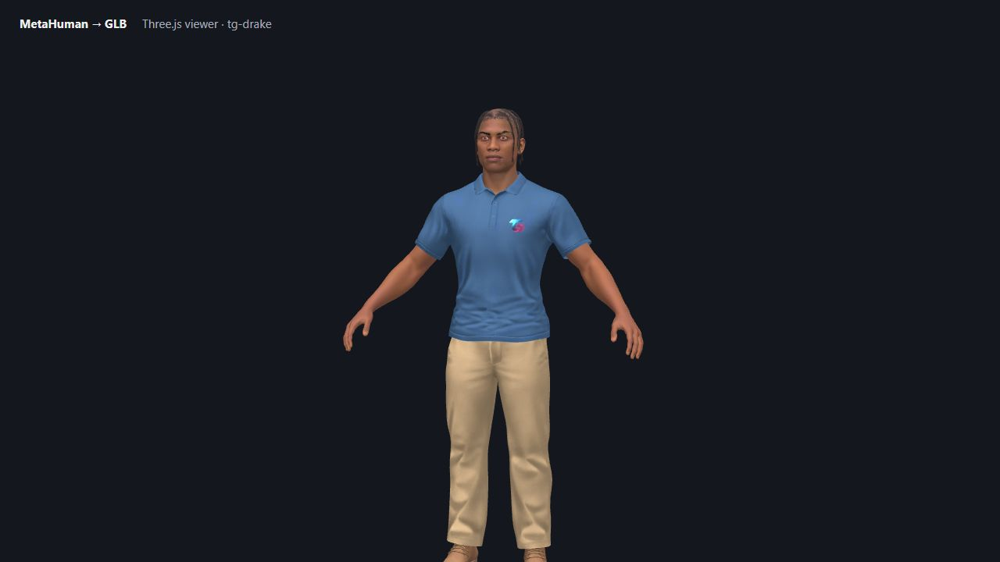
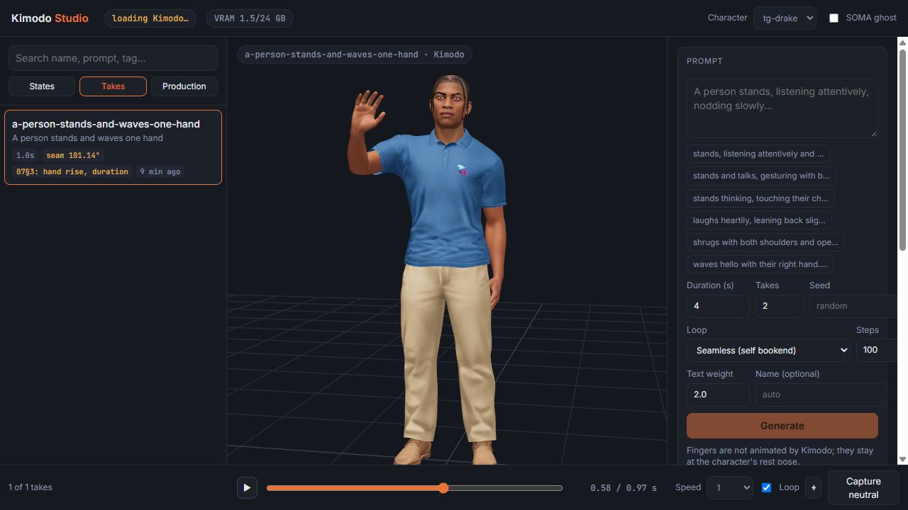

# MetaHuman → GLB for the web

Bring expressive MetaHuman characters into **Three.js and other web experiences**. This open-source project explores a practical path from Unreal Engine MetaHuman assets to browser-ready characters.

**Create in Unreal. Export to GLB. Bring your character to life on the web.**

<table>
  <tr><td align="center"><strong>Three.js GLB preview</strong></td><td align="center"><strong>Kimodo Studio motion preview</strong></td></tr>
  <tr><td></td><td></td></tr>
</table>

The same character is shown in a prototype Three.js GLB preview and in Kimodo Studio, paused during a generated wave. The screenshots illustrate a local setup; they are not a promise that every character or material exports identically.

We want to build this with web developers, character artists, technical animators, and everyone working to make digital humans practical in the browser. **Contributions to hair, clothing, and locomotion are especially welcome.** See the [roadmap](ROADMAP.md) for ideas.

> **Project status:** This is an evolving pipeline extracted from a production workflow, not yet a one-click exporter tested on every setup. Your Unreal version, MetaHuman setup, materials, and target device may require adjustments; some tools and documentation retain Telegamez-specific assumptions.

The pipeline exports a MetaHuman to a GLB with 51 ARKit-style blendshapes and builds a Three.js viewer. Kimodo Studio adds experimental motion generation and preview.

## Foundation and live demo

This project was built on the foundation of [smorchj/metahuman-to-glb](https://github.com/smorchj/metahuman-to-glb). Its [original live demo](https://smorchj.github.io/metahuman-to-glb/) currently returns a GitHub Pages 404 (checked October 2026).

## Pipeline

```
"export /Game/Foo/MHC_Foo"
   |
   00: UE assemble                         (~1-2 min)
   01: UE Sequencer ARKit bake + GLB       (~1-2 min)
   02: Blender: ARKit shape keys + groom   (~60-90 s)
   FBX weight repair → 03: Draco-compressed GLB
   04: three.js viewer build               (~5 s)
   |
   docs/characters/<id>/<id>.glb            (~40 MB, 51 ARKit blendshapes)
```

Each stage is a Python or PowerShell script. The scripts can be run directly; the optional Claude Code workflow uses stage-specific agents and a character manifest.

## ARKit blendshapes

UE's GLTFExporter strips morph names and outputs ~700 MB when you request the full 858 RigLogic morphs. `AnimSequence.get_anim_pose_at_frame()` returns curve inputs, not resolved bone transforms. RigLogic Python bindings aren't shipped (see [EpicGames/MetaHuman-DNA-Calibration #43](https://github.com/EpicGames/MetaHuman-DNA-Calibration/issues/43)).

The approach that works: build a transient Level Sequence with `AS_MetaHuman_ARKit_Mapping` at 24fps (one integer frame per ARKit pose), call `SequencerTools.export_level_sequence_fbx()`. Sequencer runs RigLogic + correctives natively and outputs an FBX with per-frame bone keyframes. Stage 02 replays that in Blender, scrubs to each frame, captures the deformed mesh via `evaluated_get(depsgraph)`, and transfers shape keys to the GLB face mesh by KDTree position match. Eyebrow, mustache, and beard card meshes get the same shapes propagated via k=4 inverse-distance-squared weighting.

## Setup

1. Clone the repo.
2. Copy the config template and fill in your local paths:
   ```
   cp _config/pipeline.example.yaml _config/pipeline.yaml
   ```
   Required: project, Unreal Editor and Blender paths. Fill in both the `ue_by_version."5.7"` fields and the legacy `ue_project_path` / `ue_editor_cmd` fields; the FBX reweight step reads the latter. Python and PowerShell 7 are required. Viewer validation requires Playwright and Chromium (`pip install playwright`, then `playwright install chromium`). Close other Unreal Editor instances before assembly.

   The example config describes UE 5.8.1 on the reference machine and Blender checked against 4.4.1. The `5.7` directory is a pipeline label; a verified compatibility matrix is still needed.
3. Have your MetaHumanCharacter in the UE project under `/Game/<Name>/`.

`_config/pipeline.yaml` is gitignored.

## Usage

Bootstrap your character first, choosing the applicable body archetype:

```powershell
python 5.7/native-glb/tools/bootstrap_character.py --asset /Game/Ada/MHC_Ada --body female
```

Use `--body male` when appropriate. Bootstrap supports `--id` for a different output ID. The direct steps below are Windows-oriented and have not yet been independently verified as a clean-machine tutorial.

In Claude Code (some examples in RUN.md may lag current bootstrap arguments):

```
export /Game/Ada/MHC_Ada
```

To run a single stage directly:

```powershell
./5.7/native-glb/stages/00-unreal-assemble/tools/run_assemble.ps1 -Char ada
./5.7/native-glb/stages/01-unreal-glb-export/tools/run_export.ps1   -Char ada
./5.7/native-glb/stages/02-blender-assemble/tools/run_assemble.ps1  -Char ada
./5.7/native-glb/tools/run_fbx_reweight.ps1                         -Char ada
./5.7/native-glb/stages/04-webview-build/tools/run_site.ps1         -Char ada
```

The FBX reweight step repairs skin weights and runs stage 03 itself; do not skip it. Serve the resulting `5.7/native-glb/docs/` directory over HTTP to inspect the viewer. The [publisher](PUBLISHER.md) targets Telegamez infrastructure and is not required for a standalone viewer.

## Layout

```
5.7/native-glb/
  RUN.md                          orchestrator entry point
  tools/bootstrap_character.py   scaffolds characters/<id>/
  stages/
    00-unreal-assemble/
      CONTEXT.md                  stage contract
      tools/run_assemble.ps1
    01-unreal-glb-export/
    02-blender-assemble/
    03-export-to-glb/
    04-webview-build/
  characters/
    _template/
    <id>/manifest.json            per-stage status
  docs/characters/<id>/<id>.glb   GitHub Pages output

5.6/cinematic/                    legacy pipeline
```

## Status

Running with **Bo** and **Bruce** (5.7 native-glb) and **Ada** and **Taro** (5.6 cinematic). Tested in Safari on iPhone X.

What the 5.7 pipeline produces:

- 51 ARKit blendshapes (`tongueOut` needs a non-default rig variant)
- Correct deformation magnitudes (jawOpen ~33mm, eyeBlinkLeft ~16mm, etc.)
- Facial hair card meshes follow face blendshapes via IDW propagation
- Hair rendering: alpha-to-coverage primary, two-pass blend fallback. Per-strand root darkening and tint variance from atlas channels. Anisotropic specular along strand tangent. Per-character and per-material mode/colour/density overrides.
- Texture cap 1024px, Draco compression, ~40 MB output
- MediaPipe FaceLandmarker live face capture in the viewer

Known gaps:

- Eyelash textures look low-res. The 1024px downsample cap may be hurting coverage textures ([#13](https://github.com/smorchj/metahuman-to-glb/issues/13)).
- Eye occlusion mesh has no alpha mask. Currently renders as a flat 40% dark layer over the whole eye ([#19](https://github.com/smorchj/metahuman-to-glb/issues/19)).
- No scalp darkening under hair cards ([#15](https://github.com/smorchj/metahuman-to-glb/issues/15)).
- `browInnerUp` is a single bilateral blendshape. Left/right asymmetry is lost ([#17](https://github.com/smorchj/metahuman-to-glb/issues/17), [#18](https://github.com/smorchj/metahuman-to-glb/issues/18)).
- FBX bake captures bone deformation only. Fine morph correctives (lip squash, wrinkle deltas) are lost (~5-10mm).
- Clothing base colour is wrong. Mask-blended `diffuse_color_1/2` not wired through ([#12](https://github.com/smorchj/metahuman-to-glb/issues/12)).

## Legacy

The 5.6 cinematic pipeline (`5.6/cinematic/`) used a precomputed NPZ to transplant ARKit shapes. Still works for Ada and Taro but is no longer the recommended path. The 5.7 pipeline derives ARKit deformation natively.

`5.7/cinematic/` exists but is unfinished.

## Help build it

You do not need to be an Unreal specialist. Reproductions, documentation, Three.js examples, art and animation work, and tests on different devices are all valuable.

- **Hair:** card rendering, coverage, transparency, shading, scalp blending, facial hair, and performance.
- **Clothing:** material reconstruction, skin weights, clipping, layering, and deformation across outfits.
- **Locomotion:** retargeting, walk and run cycles, transitions, root motion, foot contact, and browser-friendly controls. [NVIDIA Kimodo](https://github.com/nv-tlabs/kimodo) and [MotionBricks](https://github.com/NVlabs/motionbricks) are promising research directions; The [experimental Kimodo Studio and bridge](experimental/kimodo/) provide local generation, browser preview, and Unreal retargeting; MotionBricks remains a research direction.

See the [roadmap](ROADMAP.md) for concrete contribution ideas. Small pull requests are welcome. Include OS, Unreal and Blender versions, pipeline stage, logs, and a minimal reproduction or screenshots where possible. Remove private paths and do not upload assets you cannot redistribute. Issues and Discussions may need to be enabled by maintainers; until then, use pull request discussion for proposed changes.

## License and assets

Project software is [MIT licensed](LICENSE). Character, texture, and animation assets may have separate rights or terms; MIT does not automatically relicense third-party content. Check applicable terms before use or redistribution. Epic states that [MetaHumans can be used with other engines and creative software](https://www.metahuman.com/license); review the terms relevant to your use. An asset provenance inventory is a roadmap priority.
